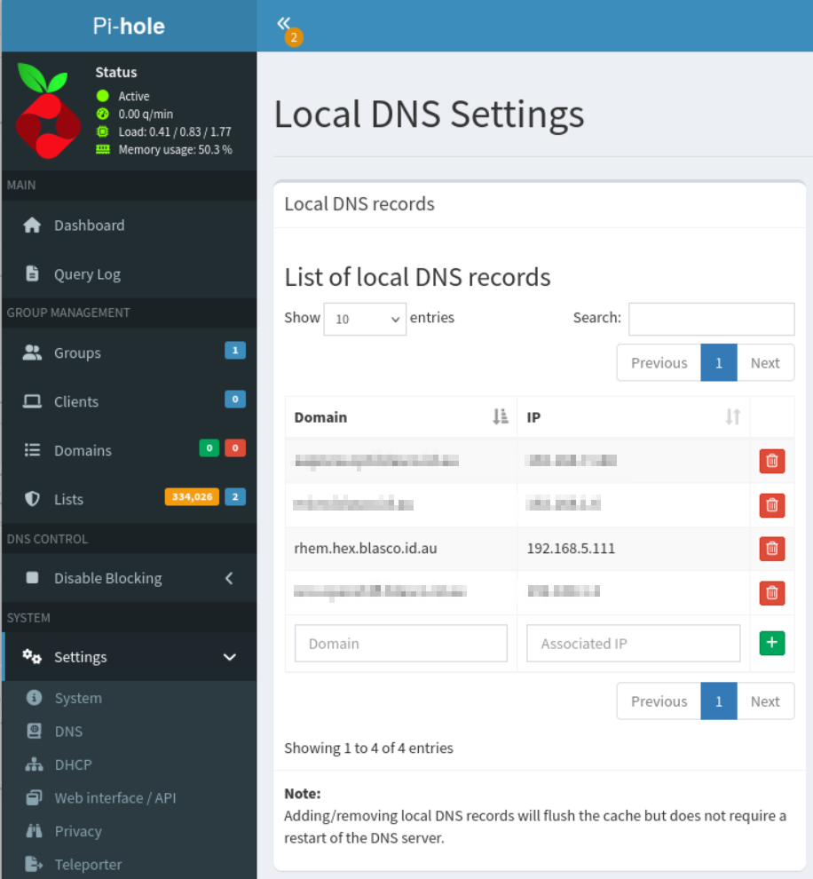

# Scratchpad for my home lab specifics

## Build the VM

```bash
ansible-playbook libvirt-createvm.yml   -e hypervisor_host=hex.lan   -e "vm_host_network=vm-network-routed"   -e distribution_version=rhel103 -e vm_hostname=rhem -e vcpus=4 -e disk_size=70GB -e memory_mb=24576 -e vm_start=yes
```

## Add to DNS

Grab the IP address from the hypervisor:
```bash
[root@hex ~]#  virsh net-dhcp-leases --network vm-network-routed
 Expiry Time           MAC address         Protocol   IP address         Hostname   Client ID or DUID
----------------------------------------------------------------------------------------------------------
 2026-11-26 00:16:56   52:54:00:ea:f4:e2   ipv4       192.168.5.111/24   -          01:52:54:00:ea:f4:e2
```

IP: 192.168.5.111
Hostname: rhem.hex.blasco.id.au

Pi-hole local DNS record (`rhem.hex.blasco.id.au` → `192.168.5.111`):



## RHEL registration and basic config

```bash
ansible-playbook rhelconfigure.yml --limit=rhem
```

## RHEM RPM install (this repo)

Manual steps: [README.rhem-install-rpm.md](README.rhem-install-rpm.md)

```bash
cd ansible
ansible-galaxy collection install -r requirements.yml
# vault.yml from vault.yml.example — see ansible/README.md
ansible-playbook playbooks/rhem-install-rpm.yml
```

Inventory: `ansible/inventory/hosts.yml` — group `rhem_servers`.