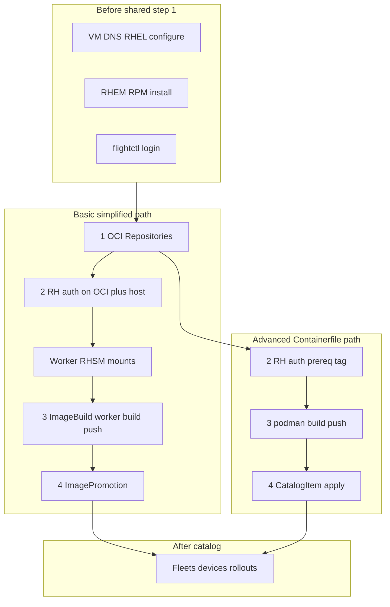

# Scratchpad for my home lab specifics

## Build the VM

```bash
ansible-playbook libvirt-createvm.yml   -e hypervisor_host=hex.lan   -e "vm_host_network=vm-network-routed"   -e distribution_version=rhel103 -e vm_hostname=rhem -e vcpus=4 -e disk_size=70GB -e memory_mb=24576 -e vm_start=yes
```

## Add to DNS

Grab the IP address from the hypervisor:
```bash
[root@hex ~]#  virsh net-dhcp-leases --network vm-network-routed
 Expiry Time           MAC address         Protocol   IP address         Hostname   Client ID or DUID
----------------------------------------------------------------------------------------------------------
 2026-11-26 00:16:56   52:54:00:ea:f4:e2   ipv4       192.168.5.111/24   -          01:52:54:00:ea:f4:e2
```

IP: 192.168.5.111
Hostname: rhem.hex.blasco.id.au

Pi-hole local DNS record (`rhem.hex.blasco.id.au` → `192.168.5.111`):


## RHEL registration and basic config

```bash
ansible-playbook rhelconfigure.yml --limit=rhem
```

## RHEM RPM install (this repo)

Manual steps: [README.rhem-install-rpm.md](README.rhem-install-rpm.md)

```bash
cd ansible
ansible-galaxy collection install -r requirements.yml
# vault.yml from vault.yml.example — see ansible/README.md
ansible-playbook playbooks/rhem-install-rpm.yml
```

Inventory: `ansible/inventory/hosts.yml` — group `rhem_servers`.

## Grafana container demo

Direct Podman (baseline):

```bash
podman run -d --rm \
  --name grafana-demo \
  -p 3000:3000 \
  docker.io/grafana/grafana:latest
```

Then browse to `http://<RHEL-host-IP>:3000` — user `admin`, password `admin`.

### Software Catalog (quadlet CatalogItem)

Full write-up: [README.catalog-quadlet.md](README.catalog-quadlet.md). Manifest: `catalog/applications/grafana-demo/catalogitem.yaml`.

Ansible (from repo `ansible/` dir, vault as for install playbook):

```bash
ansible-playbook playbooks/rhem-catalog-grafana-demo.yml --ask-vault-pass
```

Or manual on the RHEM host after `flightctl login` ([README.rhem-use.md](README.rhem-use.md)):

```bash
flightctl apply -f catalog/applications/grafana-demo/catalogitem.yaml
flightctl get catalogitem grafana-demo --catalog default
```

Fleet consumption (`appType: quadlet` + `catalogItemRef`) is a separate task; stub in the catalog README.

## High level flow

Prerequisites (VM, DNS, RHEL, and sections above cover most of this):

0. Install RHEM, `flightctl login`, and—for the **basic** path only—image builder worker RHSM subscription ([README.image-builds-basic.md](README.image-builds-basic.md))

Shared image-build setup:

1. Define OCI source/destination repositories (`Repository` resources)
2. Add Red Hat registry credentials (basic: host `podman login` **and** OCI `Repository` `ociAuth`; advanced: Ansible `prereq`)

**Basic** (simplified `ImageBuild`, [README.image-builds-basic.md](README.image-builds-basic.md)):

3. Run `ImageBuild` — worker builds and pushes to the destination registry
4. Publish via `ImagePromotion` — creates the Software Catalog item

**Advanced** (Containerfile + Podman, [README.image-builds-advanced.md](README.image-builds-advanced.md)):

3. `podman build` / `podman push` to the lab registry
4. Register the image in the Software Catalog (`CatalogItem`; no `ImagePromotion`)

After catalog registration: fleets, devices, rollouts ([README.image-builds-advanced.md](README.image-builds-advanced.md)).


